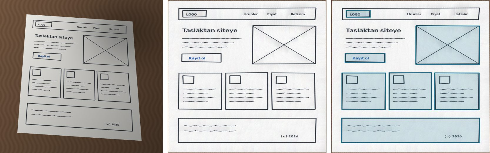

# Sketch-to-Code

Kâğıda çizilmiş bir web sayfası taslağının fotoğrafını düzeltir, düzeni algılar ve Gemini ile
çalışan, tek dosyalık bir HTML sayfasına çevirir. Üretilen sayfa yalıtılmış bir çerçevede,
gerçek cihaz genişliğinde önizlenir; sohbetle düzeltilir ve sürümlenir.

[](https://github.com/rose-omer/Sketch-to-Code-AI/actions/workflows/ci.yml)
[](https://www.python.org/downloads/)
[](LICENSE)



*Soldan sağa: masada çekilmiş fotoğraf, perspektifi ve gölgesi düzeltilmiş çizim, modele düzen
ipucu olarak giden kutular. Görüntü `sketch2code/samples.py` ile üretilen örnektir.*

## Akış

1. **Yükle.** JPG ya da PNG (en çok 10 MB), telefonda kamera, ya da "Örnekle dene".
2. **Düzelt ve incele.** Görüntü hattı çalışır; orijinal, düzeltilmiş ve kutulu görüntü yan yana
   görünür. Kâğıt bulunamazsa uyarı çıkar ve elle kırpma açılır. Palet hex etiketleriyle listelenir.
3. **Üret ve düzenle.** Kod akarak gelir. Önizleme masaüstü (1280), tablet (768), mobil (375) ya da
   yan yana açılır. "Kartları üç sütun yap" gibi isteklerle sayfa yeniden yazılır; her istek yeni
   bir sürümdür. Geri alma, sürüm farkı, HTML ve ZIP indirme vardır.

## Mimari

```
fotoğraf ─► sketch2code/vision.py ─► düzeltilmiş renkli görüntü + kutular (JSON)
                                           │
                                           ▼
            sketch2code/prompts.py ─► sketch2code/llm.py (google-genai, oturum başına Client)
                                           │  akış
                                           ▼
            sketch2code/preview.py ─► sandbox iframe (opak köken, CSP) ─► st.iframe
```

| Modül | Görev |
|---|---|
| `sketch2code/vision.py` | EXIF yönü, RGB'ye çevirme, kâğıt bulma (Otsu + Canny), perspektif, gölge alma, CLAHE, eğim, kutu algılama |
| `sketch2code/palette.py` | KMeans ile baskın renkler |
| `sketch2code/llm.py` | Gemini istemcisi, akış, tek yeniden deneme, hata türleri, yapılandırılmış öneriler (Pydantic) |
| `sketch2code/prompts.py` | Sistem talimatı ve istemler; kullanıcı metni sınırlayıcı etiket içinde ve 600 karakterle sınırlı |
| `sketch2code/preview.py` | Güvenli önizleme sarmalayıcısı |
| `sketch2code/history.py` | Sayfa başına sürümler, geri alma, fark |
| `sketch2code/export.py` | ZIP ve proje dosyası (.json) |
| `sketch2code/quota.py` | Herkese açık demo için günlük üretim sınırı |
| `eval/` | Değerlendirme hattı (SSIM, blok eşleşmesi) |
| `ui/`, `app.py` | Streamlit arayüzü |

`sketch2code/` Streamlit'e bağlı değildir; test edilebilir saf fonksiyonlardan oluşur.

## Güvenlik ve veri

- **Önizleme yalıtımı.** Model çıktısı güvenilmez sayılır. Sayfa `sandbox="allow-scripts"` ile açılan
  iç iframe'de çalışır; `allow-same-origin`, `allow-top-navigation`, `allow-forms`, `allow-popups`
  verilmez. Belge opak kökendedir: Streamlit sayfasına, çerezlere ve üst pencereye erişemez.
  Belgenin başına CSP eklenir: ağ isteği yok, betik ve stil yalnız Tailwind ve jsDelivr CDN'lerinden.
  Bu davranış Playwright testleriyle gerçek tarayıcıda doğrulanır.
- **Anahtar.** Sıra: `st.secrets["GEMINI_API_KEY"]` → `GEMINI_API_KEY` ortam değişkeni → kenar
  çubuğu (kendi anahtarınızı getirin). Her oturum kendi `genai.Client` nesnesini kullanır; süreç
  geneli yapılandırma yoktur. Anahtar diske yazılmaz.
- **Veri kullanımı.** Gemini ücretsiz katmanında Google gönderilen içeriği ürün geliştirmede
  kullanabilir. Gizli çizim yüklemeyin.

## Kurulum

Python 3.12 gerekir.

```bash
python -m venv .venv
# Windows: .venv\Scripts\activate    macOS/Linux: source .venv/bin/activate
pip install --only-binary :all: -r requirements.txt
```

Anahtarı [Google AI Studio](https://aistudio.google.com/apikey) üzerinden alın. İsterseniz
`.streamlit/secrets.toml` dosyasına yazın (repoya girmez):

```toml
GEMINI_API_KEY = "..."
```

## Çalıştırma

```bash
streamlit run app.py --server.port 8101
```

| Ortam değişkeni | Varsayılan | Açıklama |
|---|---|---|
| `GEMINI_API_KEY` | yok | Yoksa kenar çubuğundan girilir |
| `MODEL_CODE` | `gemini-4-hydrogen` | Kod üretimi ve sohbetle düzeltme |
| `MODEL_FAST` | `gemini-3.5-flash-lite` | Öneriler (JSON) |
| `DAILY_GENERATION_LIMIT` | yok (sınırsız) | Herkese açık demo: sahibin anahtarıyla ziyaretçi (IP özeti) başına günlük üretim sayısı. Kullanıcı kendi anahtarını girerse uygulanmaz. |

Model adları kenar çubuğundaki "Gelişmiş" bölümünden de değişir. Tema Streamlit ayar menüsünden
açık ya da koyu seçilir; önizleme her zaman üretilen sayfanın kendi renkleriyle açılır.

## Geliştirme

```bash
pip install --only-binary :all: -r requirements-dev.txt
ruff check . && ruff format --check .
pytest -m "not browser"          # birim + arayüz (AppTest) testleri, sahte Gemini istemcisiyle
playwright install chromium      # bir kez
pytest -m browser                # sandbox ve medya sorgusu testleri, gerçek Chromium
```

Testler gerçek Gemini çağrısı yapmaz. CI (`.github/workflows/ci.yml`) lint, birim ve tarayıcı
testlerini Python 3.12 ile koşar.

## Değerlendirme

`eval/` hattı çizimden kod üretir, Playwright ile 1280 px'te render eder ve hedef sayfayla karşılaştırır.

- Kipler: `raw` (fotoğraf olduğu gibi), `binary` (gri + uyarlanır eşik, eski yöntem), `pipeline`
  (`vision.py` hattı + kutu ipucu).
- Ölçütler: SSIM (gri, 640 px), blok konumu eşleşmesi (DOM blokları, IoU ile birebir eşleme),
  üretim süresi, çıktı uzunluğu.
- Veri: [Sketch2Code](https://huggingface.co/datasets/SALT-NLP/Sketch2Code-hf) veri setinin yerel kopyası.
  Klasörde `<sayfa>.html` ve `<sayfa>_<n>.png` çiftleri olmalı. Veri repoya girmez; lisansını
  kullanmadan önce okuyun.

```bash
python -m eval.run --data ./veri --subset 5 --dry-run   # API çağrısı yok; hattı sınar, skor ≈ 1
python -m eval.run --data ./veri --subset 30            # GEMINI_API_KEY ister; eval/results.md yazar
```

Sonuç tablosu henüz yok: ölçüm gerçek API çağrısı ve veri seti gerektirir. Tablo `eval/results.md`
dosyasına yazılınca buraya özeti eklenecek.

## Yol haritası

- `eval/results.md` ölçümü ve README'ye sayısal özet.
- Öz denetim: üretilen sayfayı Playwright ile render edip eksik bölge ve taşmayı modele sordurmak
  (Docker dağıtımında, `ENABLE_SELF_CHECK=1`).
- Docker imajı ve barındırılan demo.

## Lisans

MIT. Ayrıntı: [LICENSE](LICENSE).
